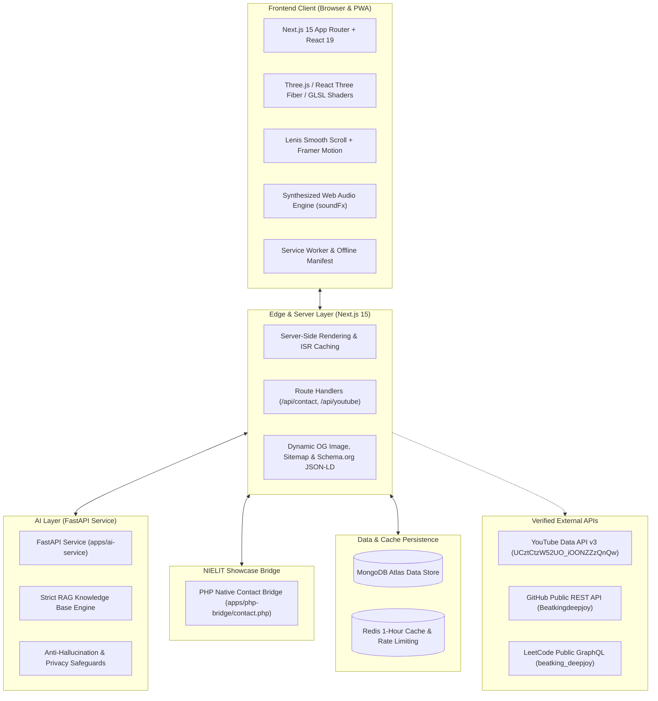

# System Architecture & Technical Specifications

**Platform**: Deepjoy Bhowmik 3D Portfolio & YouTube Creator Brand Platform  
**Target Identity**: Deepjoy Bhowmik (B.Tech CSE, ICFAI University Tripura | Agartala, India)  
**Theme**: "Northeast Night Coder" (Cinematic dark world, cosmic glowing desk, floating code glyphs, silhouetted Tripura hills, drifting fireflies)

---

## 1. High-Level Architecture



---

## 2. Directory Structure

```text
d:/MY PORTFOLIO/
├── apps/
│   ├── web/                           # Next.js 15 + React 19 Frontend
│   │   ├── app/
│   │   │   ├── (site)/
│   │   │   │   ├── page.tsx           # Primary 3D universe page
│   │   │   │   ├── projects/[slug]/   # Case study detail pages
│   │   │   │   ├── blog/              # MDX blog listing
│   │   │   │   ├── blog/[slug]/       # MDX article view
│   │   │   │   ├── resume/            # Interactive CV with print stylesheet
│   │   │   │   └── guestbook/         # Visitor book
│   │   │   ├── admin/page.tsx         # Protected admin console (phone toggle, inbox)
│   │   │   ├── api/                   # Contact & YouTube API handlers
│   │   │   ├── layout.tsx             # Root layout with metadata & JSON-LD
│   │   │   └── not-found.tsx          # 3D interactive 404
│   │   ├── components/
│   │   │   ├── sections/              # Hero, About, SkillsGalaxy, ProjectsBento, ExperienceTimeline, YouTubeDashboard, GitHubLeetCode, SponsorCollab, ContactSection, Footer
│   │   │   ├── three/                 # Three.js R3F scenes, FireflyField, LaptopShowcase, Fallbacks
│   │   │   ├── motion/                # CustomCursor, SmoothScroll, CommandPalette, KonamiListener, TerminalEasterEgg
│   │   │   └── ai/                    # Floating Ask Deepjoy AI widget
│   │   ├── lib/
│   │   │   ├── data/                  # Verified portfolio, blog, and project data
│   │   │   ├── sound/                 # Web Audio API synthesized sound generator
│   │   │   └── i18n/                  # English, Hindi, Bengali translations
│   │   └── public/                    # PWA manifest, favicons, static PDFs
│   ├── ai-service/                    # Python FastAPI grounded RAG service
│   │   ├── main.py
│   │   └── rag/knowledge_base.json
│   └── php-bridge/                    # NIELIT backend demonstration
│       └── contact.php
├── packages/
│   └── shared-types/                  # Shared TypeScript interfaces
├── infra/
│   ├── docker/web.Dockerfile
│   └── docker-compose.yml
├── .github/workflows/ci-cd.yml
├── .env.example
├── ARCHITECTURE.md
└── README.md
```

---

## 3. Creative & 3D Engineering Architecture

### 3.1 "Northeast Night Coder" Visual Aesthetic
- **Color Space**: Dark void background (`#05050A`), deep night indigo (`#0B0B14`), glassmorphism cards (`rgba(255,255,255,0.04)` with `backdrop-filter: blur(16px)`), electric cyan (`#22D3EE`), cyber violet (`#7C3AED`), and glow magenta (`#E879F9`).
- **Tripura Terrain Synthesis**: Generative procedural hills mesh rendered with `MeshDistortMaterial` portraying the rolling silhouetted hills and tea garden terraces of Tripura under twilight.
- **Atmospheric Firefly Simulation**: Custom particle system (`FireflyField.tsx`) simulating bioluminescent fireflies drifting across the canvas.
- **Adaptive GPU Benchmark & Graceful Fallback**: Detects `prefers-reduced-motion` and low-power devices (mobile cores ≤ 4), dynamically falling back to an ultra-optimized lightweight 2D canvas (`LightweightUniverseFallback.tsx`) guaranteeing 60 FPS on all devices.

---

## 4. Privacy & Data Guardrails

1. **Zero Hallucination Policy**: All identity facts, student leadership milestones, repository counts (43), and project progress (SHUDH DESI 80%) are hardcoded to ground truth or fetched live.
2. **Phone Number Redaction**: Deepjoy's phone number is withheld from all public views and CV renders by default. It can only be revealed if toggled explicitly in the protected Admin Console.
3. **Graceful External API Fallbacks**: If YouTube Data API v3 or GitHub API endpoints exceed quota or fail network connections, baseline verified data is served seamlessly without breaking UI or inventing numbers.
